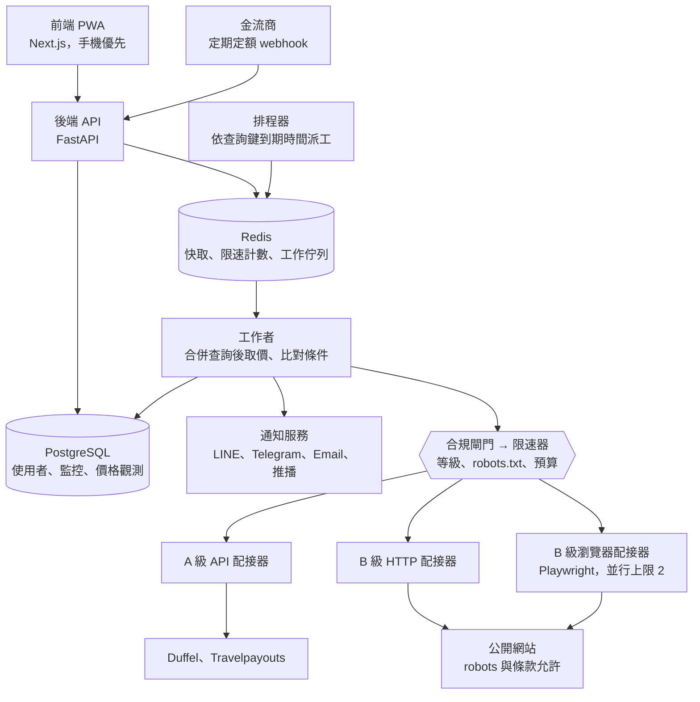

# 機票飯店比價監控系統 規格書

> 版本：2026-10-23　｜　用途：交給 Claude Code 依階段實作
> 給 Claude Code：開發規則見 repo 根目錄的 `CLAUDE.md`。請一次只實作一個階段（見第十一章），從 P0 開始。第二章「合規閘門」是硬性約束，任何程式碼都不得繞過。

---

## 〇、做法說明（先讀這段）

**一句話：能用官方管道就用官方管道；條款允許的公開網站才低頻擷取；其餘網站只給跳轉連結，不發任何請求。**

為什麼這樣做：

1. **「合不合法」看的是有沒有被允許，不是用什麼技術。** 大型訂票網站和多數航空公司的服務條款禁止「任何自動化方式」存取，不管是直接打 API、用 HTTP 抓頁面，還是模擬真人操作瀏覽器，都屬於自動化存取。
2. **所以系統把每個來源先分級（A/B/C），程式只對 A、B 級發請求。** A 級是官方 API 或聯盟資料，B 級是條款與 robots.txt 都允許的公開頁面，C 級是禁止或有防護的網站。
3. **C 級網站不是放棄，而是改成「跳轉連結 + 聯盟佣金」。** 使用者在我們這裡看到 A、B 級的價格，想看 C 級網站的價格就一鍵跳過去，帶好日期與人數。
4. **省錢靠「合併查詢 + 快取 + 自適應頻率」，不靠大量爬取。** 100 個人監控同一航段同一天，只查一次。
5. **收費只賣「監控與通知」，不碰訂票與代收款。** 代訂需要旅行業執照，可用於第三方消費的儲值金會落入電子支付監理。

### 關於「模擬真人操作」

結論：**不能讓 C 級網站變合法，反而會提高風險；但可以用在 B 級網站上。**

| 情境 | 判斷 | 原因 |
| --- | --- | --- |
| 用瀏覽器自動化（Playwright）讀 B 級網站，User-Agent 誠實表明身分 | 可以 | 已在本規格內，用於需要 JavaScript 才能顯示價格的頁面 |
| 模擬滑鼠軌跡、隨機延遲、偽造瀏覽器指紋、輪換住宅 IP，去讀條款禁止的網站 | 不可以 | 仍是自動化存取，違反條款；這些手法的目的就是規避防護，在台灣可能涉及刑法第 358 條「破解保護措施」，也最容易被認定為惡意 |
| 破解或代解驗證碼 | 不可以 | 直接屬於規避保護措施 |
| 使用者自己開瀏覽器看網頁，由使用者安裝的擴充功能讀取「他自己正在看的那一頁」價格 | 灰色但風險低很多，列為日後選項 | 是真人在操作，不是伺服器在爬；但仍要讀各站條款，且不能 24 小時自動跑，只能做「瀏覽時順便記錄」 |

另外，模擬真人在工程上也不划算：要跑完整瀏覽器、要買代理 IP、要一直跟反機器人機制對抗，成本是純 API 的數十倍，而且隨時會被封鎖，24 小時監控的可靠度做不起來。

---

## 一、專案概述

**目標**

1. 免費使用者：像 Skyscanner 一樣搜尋機票與飯店，看到各來源價格，點擊跳轉到原網站訂購。
2. 付費使用者：設定監控條件（航線或飯店、日期、目標價），系統全天候檢查，達標即推播通知。
3. 營運成本：優先使用免費來源與快取，主機以單台小型主機起步。
4. 介面：手機優先，搜尋首屏 3 秒內出現結果，建立監控最多 2 步。

**本期不做**

- 自動下訂與代付款：替他人訂機票、飯店屬旅行業務，需旅行業執照；本系統只通知加跳轉。
- 可用於購買第三方商品的儲值金：會落入電子支付監理；收費一律採訂閱制。
- 任何規避網站防護的手段：破解驗證碼、輪換代理 IP 躲封鎖、偽造瀏覽器指紋、模擬人類行為以避開偵測、登入後擷取。
- 複製他站內容：飯店照片、評論、介紹文字不擷取、不展示。

---

## 二、合法性原則與來源合規分級

每個來源上線前都要先分級，程式只能對 A、B 級來源發出請求。大型訂票網站與多數航空公司的服務條款禁止自動擷取，預期會落在 C 級，這是正常的。

| 等級 | 判定條件 | 系統行為 |
| --- | --- | --- |
| A 官方管道 | 有官方 API、聯盟資料源或書面授權 | 依合約額度呼叫，可供監控使用 |
| B 公開可取 | 無需登入、robots.txt 允許該路徑、服務條款未禁止自動存取 | 低頻擷取，受積極限速，只取價格事實 |
| C 不擷取 | 條款禁止、robots.txt 禁止、需登入或有反機器人防護 | 不發任何請求，只提供帶參數的跳轉連結 |

**合規閘門（程式強制執行）**

1. 來源登錄表必填：等級、條款網址、審閱日期、審閱人、允許的路徑、限速。未登錄或審閱超過 180 天的來源，引擎拒絕執行。
2. 每次請求前即時檢查 robots.txt（快取 24 小時），不允許就放棄並告警。
3. User-Agent 表明服務名稱與聯絡信箱，不假冒一般瀏覽器。
4. 收到 403、429、驗證碼頁或封鎖頁：立即暫停該來源，不重試、不換 IP，改為人工複審。
5. 不登入、不繞過付費牆、不呼叫網站未公開的內部 API（除非 A 級授權）。
6. 不使用規避偵測的技術：不偽造指紋、不模擬人類滑鼠軌跡、不使用 stealth 外掛、不使用代理 IP 池。
7. 只儲存價格事實（航班號、日期、房型名、金額、幣別、取得時間），展示時標明來源並導回原站。
8. 每筆請求寫入稽核日誌：來源、網址、robots 判定、回應碼、時間，保留 1 年。

**對應的法律風險（台灣）**

| 法律 | 主要風險 | 本規格如何避開 |
| --- | --- | --- |
| 刑法第 358 條 | 破解保護措施、利用帳密進入系統 | 不登入、不繞驗證碼、不躲封鎖、不偽裝 |
| 刑法第 360 條 | 大量請求干擾對方系統致生損害 | 每網域限速與每日上限 |
| 公平交易法第 25 條 | 大量搬用他人成果，可能構成顯失公平 | 只取價格事實、導流回原站 |
| 著作權法 | 照片、評論、介紹文字的重製 | 不擷取、不展示他站內容 |
| 服務條款（契約） | 違反禁止自動存取條款 | 條款禁止即列 C 級 |
| 個人資料保護法 | 使用者資料蒐集與利用 | 最小蒐集，見第十章 |

本表是工程設計依據，不是法律意見；收費上線前，來源分級結果應請律師複核。

---

## 三、資料來源策略

四類網站都納入，但取得方式依分級決定：先接官方 API，再逐站審核 B 級，其餘一律跳轉連結。Amadeus 自助 API 已於 2026 年 7 月 17 日停用，不列入。

| 類別 | 預設取得方式（A 級） | 備案 | 備註 |
| --- | --- | --- | --- |
| 航空公司 | Duffel API（彙整多家航空公司即時票價） | 航空公司官方合作夥伴 API；否則 C 級跳轉 | 部分廉航官網可能符合 B 級，逐站審核 |
| 機票訂票、比價網 | Travelpayouts Data API（免費聯盟 token，快取價格） | 各站聯盟計畫 | 預期多為 C 級，用跳轉連結賺佣金 |
| 飯店官網 | 連鎖飯店合作夥伴計畫（待申請確認） | 單店官網若符合 B 級則低頻擷取 | 多數訂房引擎由第三方代管，需看該引擎條款 |
| 訂房網站 | Duffel Stays；各訂房平台聯盟計畫（待申請確認） | C 級跳轉 | 聯盟計畫通常限制資料用途，需讀合約 |

**來源配接器（Adapter）介面**

每個來源實作同一介面，新增網站只加一個檔案：

- `source_id`、`tier`（A/B/C）、`kind`（flight / hotel）
- `search(query) -> list[Offer]`：A、B 級實作；C 級不實作
- `deeplink(query) -> url`：所有等級都實作，帶入日期、人數、聯盟追蹤碼
- `cost_per_call`、`ttl_seconds`、`rate_limit`：給排程器計算成本與快取
- `healthcheck()`：每日檢查一次，連續失敗自動停用

---

## 四、功能需求

免費版只用快取與低成本來源；付費版才觸發排程查價與通知，這樣成本跟營收會對齊。

| 功能 | 訪客 | 免費會員 | 付費會員 |
| --- | --- | --- | --- |
| 機票搜尋（單程、來回、日期 ±3 天彈性） | ✓ | ✓ | ✓ |
| 飯店搜尋（城市或飯店名、日期、人數） | ✓ | ✓ | ✓ |
| 結果排序篩選（價格、轉機次數、航空公司、星級） | ✓ | ✓ | ✓ |
| 跳轉原站訂購 | ✓ | ✓ | ✓ |
| 收藏搜尋條件 | — | ✓ | ✓ |
| 價格歷史圖 | — | 近 30 天 | 全部 |
| 價格監控任務 | — | — | 依方案條數 |
| 觸發條件：低於目標價、降幅超過 X%、歷史新低 | — | — | ✓ |
| 日期區間監控（如「11 月任一週末」） | — | — | ✓ |
| 通知（LINE、Telegram、Email、手機推播） | — | — | ✓ |
| 每日價格摘要 | — | — | ✓ |

**關鍵規則**

- 搜尋結果每筆都顯示「資料時間」與來源，並提示「實際價格以原站為準」。
- 監控任務在出發日或入住日過後自動結束，釋出額度。
- 同一任務觸發後 6 小時內不重複通知，除非價格再降。
- C 級來源在結果頁以「到 XX 查看價格」按鈕呈現，不顯示金額。

---

## 五、系統架構與技術選型

單體後端加背景工作佇列，全部用 Docker Compose 跑在一台主機上；所有對外請求都必須經過合規閘門與限速器，不允許各配接器自行連線。

C 級來源不在圖中：它們只由前端產生跳轉連結，後端從不對其發出請求。

| 元件 | 選用 | 理由 |
| --- | --- | --- |
| 前端 | Next.js + Tailwind，PWA | 手機優先，可加到主畫面、支援推播 |
| 後端 API | Python FastAPI | 與爬取工具同語言，非同步效能好 |
| 資料庫 | PostgreSQL | 價格觀測值用時間分區表 |
| 快取與佇列 | Redis | 查詢快取、限速計數、工作佇列共用 |
| 排程與工作者 | Celery（或 arq）+ Celery Beat | 支援重試、優先序、分佇列 |
| HTTP 擷取 | httpx + selectolax | 輕量，大部分 B 級頁面夠用 |
| 瀏覽器擷取 | Playwright（僅限 B 級 JS 頁面，不裝 stealth 外掛） | 吃記憶體，獨立工作者、並行上限 2 |
| 登入 | Google、LINE 登入（OAuth） | 不存密碼 |
| 部署 | Docker Compose，單台 2 vCPU / 4 GB 主機起步 | 之後可拆工作者到第二台 |
| 監控 | Prometheus + Grafana（或 Uptime Kuma） | 追來源成功率與成本 |

---

## 六、爬取引擎與成本控制

最大的省錢手段是「合併查詢」：監控任務不直接查價，而是歸納成標準化的查詢鍵，100 人監控同一航段同一天只查一次。

**成本控制策略**

1. **查詢合併**：查詢鍵 = 來源 + 類別 + 起訖地或飯店 + 日期 + 人數 + 艙等。排程器依查詢鍵排工作，結果再分發給所有對應的監控任務。
2. **快取優先**：同一查詢鍵在 TTL 內直接回傳快取；免費搜尋永遠先回快取，再視額度補即時結果。
3. **自適應頻率**：距出發越近查越頻繁，且不超過方案上限。
4. **先 HTTP 後瀏覽器**：能用純 HTTP 解析就不開瀏覽器；開瀏覽器時封鎖圖片、字型、廣告資源。
5. **不買代理 IP**：代理 IP 主要用來躲封鎖，違反合規閘門，也是最大的隱藏成本。
6. **預算熔斷**：每個來源設每日呼叫上限與每月金額上限。達 80% 告警，且排程器自動把該來源所有查詢鍵的查詢頻率減半（P1 實作）；達 100% 由合規閘門拒絕後續請求並告警，直到下一個計數週期（隔日或隔月）。
7. **免費搜尋防濫用**：訪客每 IP 每小時 20 次、免費會員每日 100 次，超過只回快取。

**預設參數（可在後台調整）**

| 參數 | 預設值 |
| --- | --- |
| 快取 TTL：機票、飯店 | 30 分鐘、60 分鐘 |
| 監控頻率：距出發 60 天以上 | 每 12 小時 |
| 監控頻率：距出發 14–60 天 | 每 6 小時 |
| 監控頻率：距出發 14 天內 | 每 2 小時 |
| B 級來源限速 | 每網域每 10 秒最多 1 次、每日最多 500 次 |
| 瀏覽器並行上限 | 2 |
| 排程時間抖動 | ±10%，避免整點尖峰 |
| 預算達 80% 後的查詢頻率 | 原頻率減半（間隔加倍），P1 實作 |

**工作流程**：排程器取出到期的查詢鍵 → 檢查快取 → 合規閘門（等級、robots、預算）→ 限速器 → 配接器取價 → 正規化寫入價格觀測 → 比對所有相關監控任務 → 符合條件就丟入通知佇列。

---

## 七、資料模型

核心是「監控任務」與「查詢鍵」多對一，價格觀測寫在查詢鍵下，而不是使用者下。

| 資料表 | 主要欄位 | 說明 |
| --- | --- | --- |
| users | id、email、登入方式、顯示名稱、建立時間 | 不存密碼 |
| subscriptions | user_id、方案、狀態、到期日、金流訂單號 | 不存卡號 |
| sources | id、名稱、類別、等級、條款網址、審閱日期、審閱人、允許路徑、限速、每月預算、啟用狀態 | 合規閘門的依據 |
| query_keys | id、source_id、標準化參數（JSON）、雜湊值、下次執行時間、目前頻率 | 合併查詢的單位 |
| watches | id、user_id、類別、條件（JSON）、觸發規則、狀態、結束日 | 使用者的監控任務 |
| watch_query_keys | watch_id、query_key_id | 一個日期區間任務會展開成多個查詢鍵 |
| price_observations | query_key_id、商品識別（航班組合或房型）、金額、幣別、含稅與否、取得時間 | 依月分區，保留 1 年 |
| alerts | watch_id、觸發價格、觸發時間、通知管道、發送結果 | 做冷卻與統計 |
| notification_channels | user_id、管道、接收識別（LINE userId、Telegram chat_id、推播訂閱） | 可多管道 |
| fetch_logs | source_id、網址、robots 判定、回應碼、耗時、成本、時間 | 合規稽核，保留 1 年 |

金額一律存整數（最小貨幣單位）加幣別；展示時以每日匯率換算新台幣，並標示原幣金額。

---

## 八、通知機制與介面設計

介面以手機單手操作為標準，通知一則就要能決定要不要訂。

**通知管道**

| 管道 | 做法 | 成本 |
| --- | --- | --- |
| Telegram Bot | 使用者點連結綁定 chat_id | 免費，第一個實作 |
| LINE Messaging API | 官方帳號加好友綁定（LINE Notify 已停用，不可用） | 有免費則數上限，超過付費 |
| Email | 交易信服務（如 Resend、Amazon SES） | 極低 |
| 手機推播 | PWA Web Push | 免費 |

通知內容固定為：品項（航段日期或飯店入住日）、現價、目標價、降幅、來源、資料時間、一鍵跳轉連結。

**主要畫面**

1. 首頁：機票／飯店切換的搜尋框，機場輸入自動完成，日期選擇器顯示各日最低價（有快取時）。
2. 結果頁：先顯示快取結果，即時結果以串流方式補上；每筆卡片有「監控這個價格」按鈕。
3. 建立監控：條件帶入搶先填好，只問目標價與通知管道，兩步完成。
4. 我的監控：列表顯示現價、目標價、近 7 天趨勢小圖，可暫停、編輯、刪除。
5. 品項詳情：價格歷史折線圖，標出歷史低點。
6. 帳號：方案、到期日、通知管道綁定、發票紀錄。
7. 管理後台：來源登錄表、各來源成功率與成本、封鎖事件、參數調整。

**順暢度要求**：首屏載入 2 秒內（4G 手機）；快取結果 3 秒內出現；所有操作按鈕至少 44px；支援深色模式。

---

## 九、會員、方案與收費

收費採月訂閱制，定價依「監控條數 × 頻率」設計，金額待自用期測出單條監控成本後再定。

| 方案 | 監控條數 | 最高頻率 | 通知管道 | 月費 |
| --- | --- | --- | --- | --- |
| 免費 | 0 | — | — | 0 |
| 基本 | 5 | 每 6 小時 | Telegram、Email、推播 | 待定 |
| 進階 | 20 | 每 2 小時 | 全部含 LINE | 待定 |

**金流與規則**

- 金流商：綠界、藍新或 TapPay 的定期定額；卡號只在金流商端，本系統只存訂單號與狀態。
- 金流回呼（webhook）驗證簽章後才更新訂閱狀態，重複回呼要冪等。
- 不提供儲值金；若日後要做「點數」，點數只能換監控額度，不可換現、不可購買第三方商品。
- 降級或到期：超出額度的監控任務自動暫停，不刪除。
- 電子發票由金流商加值服務開立（待營運主體確定後設定）。
- 聯盟佣金是另一個收入來源：跳轉連結一律帶聯盟追蹤碼。

---

## 十、非功能需求

| 項目 | 要求 |
| --- | --- |
| 效能 | 快取搜尋 API p95 < 300 ms；監控任務延遲不超過設定頻率的 20% |
| 可用性 | 單一來源失效不影響其他來源；工作者當機後自動重啟，任務不遺失 |
| 安全 | 全站 HTTPS；API 金鑰放環境變數或密鑰管理，不進版控；後台需二步驟驗證 |
| 個資 | 只蒐集 email、登入識別、通知管道識別；提供隱私權政策與一鍵刪除帳號；刪除後 30 天內清除 |
| 可觀測性 | 各來源成功率、封鎖率、平均耗時、當月成本、通知送達率，異常發 Telegram 給管理者 |
| 備份 | PostgreSQL 每日備份，保留 14 份，存在異地 |
| 測試 | 配接器用錄製的回應做單元測試，不在 CI 打真實網站；合規閘門要有拒絕情境的測試 |

---

## 十一、開發階段與驗收標準

先做合規基礎與自用版，用真實數據定價；收費放在最後，等營運主體與法律複核都完成。每個階段過關才進下一階段。

| 階段 | 內容 | 驗收關卡 |
| --- | --- | --- |
| **P0 合規基礎** | 來源登錄表、合規閘門、robots 檢查、限速器、稽核日誌、預算熔斷 | 閘門測試全部通過：未登錄或禁止的來源一律被拒 |
| **P1 自用 MVP** | Duffel 機票查價、監控任務、查詢合併、Telegram 通知、管理者告警 | 自用 30 天無漏報；測出單條監控的月成本 |
| **P2 免費比價網頁** | Travelpayouts 快取搜尋、結果頁、跳轉連結、PWA 手機介面、價格歷史圖 | 快取結果 3 秒內出現；首屏 2 秒內載入（4G 手機） |
| **P3 來源擴充** | 飯店搜尋與監控、B 級來源逐站上線、管理後台（成功率、成本、封鎖事件） | 各來源成功率 95% 以上；封鎖事件為 0 |
| **P4 會員與付費** | Google、LINE 登入、方案額度、定期定額金流、LINE 與 Email 通知、隱私權政策 | 營運主體與律師複核完成後才對外收費 |

---

## 十一之一、部署與環境設定

開發在 Claude Code 雲端 session 進行；**24 小時運作必須部署到自己的主機**，雲端 session 只負責寫程式與測試，不會常駐執行服務。

**部署目標**

- 任一 Linux VPS（Ubuntu 24.04，2 vCPU / 4 GB 起），或家中常開的電腦
- 全部服務以 `docker compose up -d` 啟動，開機自動重啟（`restart: unless-stopped`）
- 提供 `scripts/deploy.sh`：在全新主機上安裝 Docker、拉程式碼、建立 `.env`、啟動服務，一行指令完成
- 提供 `scripts/backup.sh`：PostgreSQL 每日備份（cron）
- 提供 `docs/DEPLOY.md`：給非工程背景的人照著做的部署步驟，含截圖位置說明

**環境變數（`.env.example` 必須列出，實際值不進版控）**

| 變數 | 用途 | 取得方式 |
| --- | --- | --- |
| `DUFFEL_API_TOKEN` | Duffel 查價（先用測試金鑰） | Duffel 後台建立 |
| `TRAVELPAYOUTS_TOKEN` | Travelpayouts Data API | Travelpayouts 後台 |
| `TELEGRAM_BOT_TOKEN` | Telegram 通知 | Telegram 的 BotFather 建立 |
| `ADMIN_TELEGRAM_CHAT_ID` | 管理者告警 | 與 bot 對話後取得 |
| `DATABASE_URL`、`REDIS_URL` | 資料庫與佇列 | docker compose 內部預設 |
| `CRAWLER_CONTACT_EMAIL` | 寫進 User-Agent 的聯絡信箱 | 自填 |

**雲端開發 session 的網路規則**

- 測試一律使用 `tests/fixtures/` 的錄製回應，不打真實網站或 API。
- 需要對真實 API 做冒煙測試時，只呼叫 Duffel 測試環境。金鑰由 Claude Code 環境的「網路密鑰」在請求離開時自動加上，session 內看不到金鑰；因此程式在 `DUFFEL_API_TOKEN` 未設定時不送 `Authorization` 標頭，交給代理注入。正式主機上則從 `.env` 讀取。

---

## 十二、上線前待確認事項

- [ ] 營運主體：公務員服務法第 14 條限制公務員經營商業，收費前先確認可行的安排方式
- [ ] 律師複核：來源分級結果、服務條款、隱私權政策
- [ ] Duffel：確認台灣帳戶可申請、只搜尋不訂位的使用方式是否合約允許、搜尋層級的費用與限制
- [ ] Travelpayouts：申請聯盟帳號，確認 Data API 對台灣航線的覆蓋率
- [ ] 飯店來源：逐一申請訂房平台與連鎖飯店聯盟計畫，讀資料使用權限
- [ ] B 級候選名單：列出想納入的航空公司與飯店官網，逐站審閱條款與 robots.txt
- [ ] 金流與發票：營業登記、金流商申請、電子發票開立方式
- [ ] 定價：用自用期實測的單條監控月成本推算方案月費

---

## 參考資料

- [Amadeus Self-Service API Shutdown — AirLabs](https://airlabs.co/amadeus-self-service-api-shutdown)
- [Duffel API Report Card — Supergood](https://supergood.ai/api-report-card/duffel)
- [Best Flight Booking APIs in 2026 — Geekflare](https://geekflare.com/guides/flight-booking-api/)
- [Aviasales / Travelpayouts Data API — Apify](https://apify.com/tamgadev/aviasales-flight-data.md)
